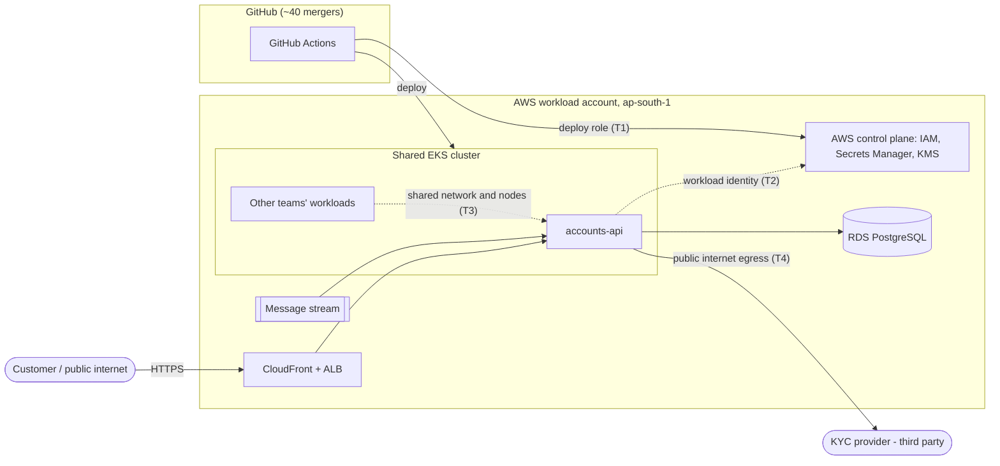

# Threat Model — accounts-api

**Scope:** `accounts-api` on a shared EKS cluster in ap-south-1, holding customer banking data. Threats are ranked by realistic attack path and impact for a regulated bank with ~40 engineers who can merge, a 2-person platform team and no security team. Every control in later sections cites one of T1–T5.

## Trust boundaries

## Top five threats (highest priority first)

**T1 — CI/CD pipeline takeover.**
*Entry:* a phished or malicious account among the ~40 mergers, a poisoned third-party action, or a PR that edits a workflow. *Reach:* the pipeline's AWS deploy role and cluster access, meaning arbitrary code in production. *Why here:* it is the most privileged path into prod, it bypasses every runtime control, and nobody is dedicated to reviewing it. *Control:* GitHub OIDC with short-lived roles bound to repo and protected branch (no static keys), least-privilege workflow permissions, actions pinned to commit SHAs, signed and SBOM-attested images in an immutable registry, required review on workflow and infra paths.

**T2 — Exploited accounts-api pod uses over-broad credentials to reach customer data.**
*Entry:* RCE or SSRF in the internet-facing API (application bug or vulnerable dependency). *Reach:* everything the pod's identity and mounted secrets allow: RDS, the stream, Secrets Manager, and the node role via IMDS. *Why here:* the bug will happen eventually; IAM decides whether it is one pod or the whole customer table. *Control:* per-workload IAM role scoped to named resources, IMDS blocked from pods, rotated DB credentials from Secrets Manager, private encrypted RDS reachable only from accounts-api, dependency and image scanning in CI.

**T3 — Lateral movement from another team's workload in the shared cluster.**
*Entry:* a compromised or misconfigured pod owned by another team, whose security posture we do not control. *Reach:* the flat pod network to accounts-api; with a privileged pod or hostPath, the node and every pod credential on it. *Why here:* the cluster's weakest tenant is effectively our perimeter. *Control:* default-deny NetworkPolicies, restricted Pod Security, namespace-scoped RBAC, admission policy rejecting privileged and host-access pods.

**T4 — Customer data exfiltration through logs or unrestricted egress.**
*Entry:* no exploit needed. An engineer logs request bodies, or an attacker already in the pod (T2) uses internet egress that was opened "for KYC". *Reach:* PII in log stores readable by far more people than the database; any exfiltration destination; the KYC API key. *Why here:* identity documents deliberately cross the public internet, and the likeliest data incident is self-inflicted. *Control:* egress limited to the KYC provider's endpoints, KYC credential in Secrets Manager, encrypted log groups with restricted access and fixed retention. *Accepted:* the provider's own security is a contractual matter, out of scope.

**T5 — Compromised privileged identity operates undetected.**
*Entry:* a stolen engineer session, or any credential gained through T1–T4. *Reach:* whatever that identity can do (exec into pods, read secrets, export snapshots), indistinguishable from normal work. *Why here:* with no security team nobody is watching, so dwell time decides the size of the breach and what we can tell the regulator. *Control:* CloudTrail and EKS audit logs shipped to a separate log-archive account, GuardDuty, and a few high-signal alerts a 2-person team can act on. *Accepted:* no 24/7 SOC, and runtime detection is limited to one high-confidence accounts-api rule; anything broader would exceed team capacity.

## Overrated here: volumetric DDoS

It tops most bank threat lists, but CloudFront and ALB provide a meaningful baseline against common volumetric attacks, backed by Shield Standard. An outage is recoverable, and its primary impact here is availability rather than direct compromise. Paying for Shield Advanced or heavy WAF tuning would spend budget and platform-team time that T1–T3 need more. Basic edge rate limiting is enough.
